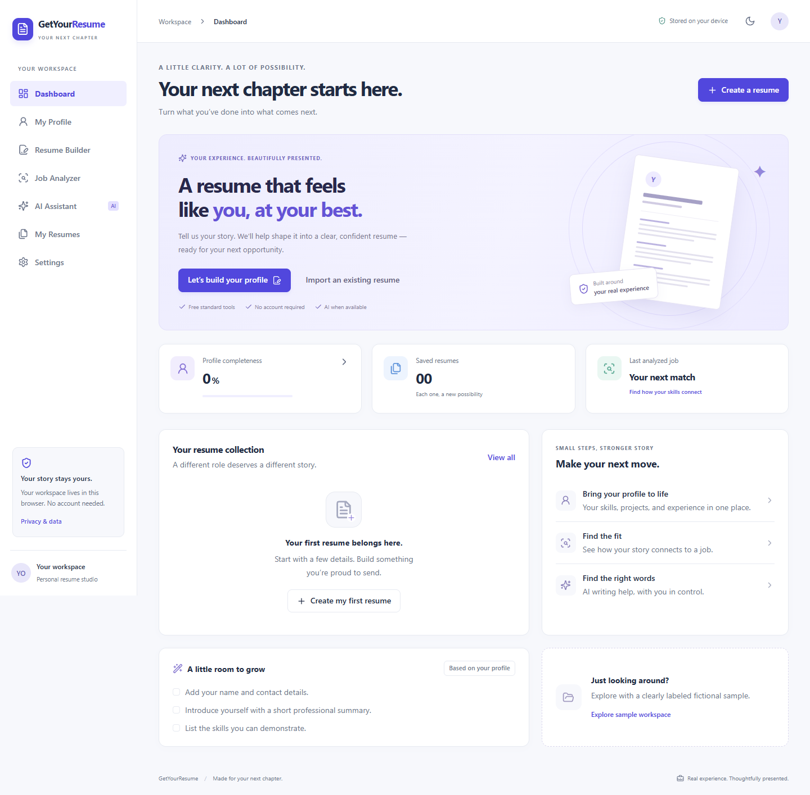
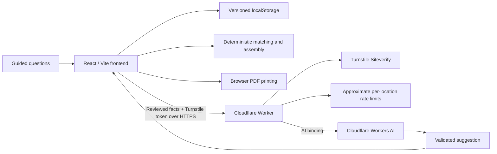

# GetYourResume

Your experience, thoughtfully presented. A personal resume studio with guided profile questions, automatic resume assembly, explainable job matching, and real hosted AI integration.

Built for an individual to create a real resume and showcase the engineering behind it. No database, subscriptions, or paid API dependencies. There is no fabricated AI in the application.

## Run locally

Requires Node.js **22.13+** (22 LTS recommended) and npm.

```powershell
cd D:\Projects_Pro\GetYourResume
npm ci
npm run dev
```

Open **http://127.0.0.1:5188**. Start with **My Profile**. The app asks about your background in six focused steps. Enter your actual details and choose **Build my resume**. In Resume Builder, use **AI** for hosted writing assistance when configured. If AI is disconnected, disabled, overloaded, or unavailable, the standard builder still assembles a resume from supplied facts. You can edit everything before applying.

Port 5188 is intentionally used to avoid common development-server conflicts. `.npmrc` uses the legacy peer resolver because npm 10's resolver crashed while exploring optional Vitest peers; required testing peers are declared explicitly. `package-lock.json` pins the resolved installation.

## Features

- A complete master career profile: contact details, summary, objective, technical and soft skills, work, internships, education, projects, certifications, achievements, awards, languages, and links.
- Add, edit, remove, and reorder entries; debounced validated local saving; clear validation and storage errors.
- Three single-column templates: **ATS Classic**, **Modern Professional**, **Developer Portfolio**. Live preview, section visibility and order, A4/US Letter, selectable-text printing.
- Version snapshots with independent content, target role/company, renaming, duplication, deletion, and modification dates.
- On-device deterministic analysis with matched/missing evidence, preferred skills, relevant experience/projects, manual-verification requirements, domain context, and explained scoring.
- Hosted AI operations for summary writing, bullet improvement, job tailoring, gap explanation, tone, and career interview questions. Review/edit/accept/reject; no automatic overwrite.
- JSON backup/restore, PDF/DOCX text extraction for manual review, explicit data deletion, light/dark theme, mobile navigation, keyboard focus, and reduced-motion support.
- Dashboard uses actual local profile and version data. The optional Alex Morgan sample is fictional and explicitly labeled.

## Screenshots

Visual QA captures are stored in `docs/screenshots/` when the screenshot test has been run. They use an empty workspace or the explicitly fictional demo, never real career data.



## Architecture



```text
apps/web/                  React application and Vite configuration
  src/components/ui/       shadcn-style owned Button/Card primitives
  src/features/profile/    Guided form, JSON restore, document text extraction
  src/features/resume/     Version editor, templates, print document
  src/features/jobs/       Job analyzer interface
  src/features/ai/         Manual AI request and review interface
  src/lib/                 Safe storage and utilities
apps/worker/               Protected Workers AI endpoints and Wrangler config
packages/shared/src/       Zod schemas, matching rules, assembly, domain types
tests/                     Domain, component, storage, Worker, browser journeys
.github/workflows/         Verification and separate manual deployments
```

React 19, strict TypeScript, Vite, Tailwind v4, locally owned shadcn/ui-style primitives (Radix Slot/CVA), Lucide, React Hook Form/Zod, and Zustand. The Worker uses the platform Request/Response routing primitives instead of a server framework. PDF.js and Mammoth are dynamically loaded only for document import. PDF/DOCX extraction produces reviewed **text**, not an unreliable automatic field mapping. Scanned PDFs without readable text are unsupported; mixed scanned/text documents may yield partial text and always need checking.

## Storage, recovery, and privacy

The schema version is `1`; the primary key is `getyourresume.workspace.v1`. Full workspace JSON and the supported older profile-only shape can be imported. Future versions, invalid data, or unreadable storage lock editing instead of overwriting the original bytes. Download original data from the recovery notice. Explicit restore preserves the previous serialized workspace at `getyourresume.workspace.v1.recovery`. A storage/quota failure keeps the previously committed workspace. A second-tab change blocks writes until reload. Backup/export is strongly recommended before leaving if storage fails.

The master profile and each resume are deep-cloned snapshots. Resume edits do not synchronize back to the master. Autosave stores valid drafts after 450 ms; invalid fields display errors and must be fixed to save. Navigation warns before leaving invalid fields. Skills use comma/newline delimiters. The app has no analytics, account login, remote database, or uploaded file storage. localStorage is **not encrypted**, can be accessed by scripts/extensions with appropriate access, and can disappear when browser data is cleared. Importing a backup replaces the workspace only after explicit confirmation. Clear-data also deletes the recovery copy.

AI context defaults omit contact fields, objectives, URLs, and unrelated metadata. Users can inspect and edit the exact facts to send. Tailoring/gap requests additionally send at most 6,000 characters of the saved job. Human verification is loaded only after consent. Cloudflare processes AI requests; do not put information you do not want processed into the displayed facts. The Worker does not persist or log career content and its observability is disabled. Provider-side processing is subject to [Cloudflare's data terms](https://developers.cloudflare.com/workers-ai/platform/data-usage/).

## Explainable matching

The curated English dictionary canonicalizes known aliases and uses phrase boundaries: `Java` does not match `JavaScript`, and `SQL` does not match `MySQL`. Profile-specific skill terms are also recognized by exact phrase. Requirements have weight **2** unless marked preferred/nice-to-have/bonus/optional/desirable, which have weight **1**. An explicit required mention overrides a preferred mention. Repeated skills count once.

**Score = round(100 × matched weighted points / recognized weighted points).** If no skills are recognized, no number is shown. A title or career objective is not evidence. Skills, summaries, project/work descriptions, education descriptions, and certifications can supply evidence; this is textual evidence, not verification of proficiency. Years, education, licensing, and authorization requirements are surfaced for manual checking and excluded from the numeric score. Unknown vocabulary can be missed. No fuzzy semantic match, keyword stuffing, or hiring prediction is claimed.

**Estimated job compatibility score — not an official ATS score or hiring prediction.**

Standard tailoring sorts existing skills/projects by relevance, retaining work-history order and all supplied facts. AI tailoring is a separately reviewed summary suggestion. It does not manufacture missing experience.

## Cloudflare setup — no billing upgrade

Frontend and Worker are deployed separately. The local frontend works without a Worker. You need a Cloudflare account to enable real hosted AI. Stay on **Workers Free**. Never enable Workers Paid, AI Gateway paid credits, or automatic overages for this project.

1. In Cloudflare, verify the account uses Workers Free and that Workers AI is available. If a screen requests a billing upgrade, stop and keep the standard builder. Review the current [pricing](https://developers.cloudflare.com/workers-ai/platform/pricing/) and [model catalog](https://developers.cloudflare.com/workers-ai/models/).
2. Create a free **Turnstile Managed** widget. Allow the actual frontend hostname, such as `yourname.github.io`; do not enter a path. For development, add `localhost`/`127.0.0.1` as needed. The site key is public; the secret is private.
3. Edit `apps/worker/wrangler.jsonc`: set `ALLOWED_ORIGINS` to your exact frontend origin(s), without path or trailing slash; set `TURNSTILE_HOSTNAMES` to the matching hostname(s). Keep the `AI` binding. Rate limit namespace IDs must be unique in your Cloudflare account.
4. From this project root:

```powershell
npx wrangler login
npx wrangler secret put TURNSTILE_SECRET --config apps/worker/wrangler.jsonc
```

Enter the secret only at Wrangler's prompt. Do not paste it into source code or the frontend environment.

5. The configured model is `@cf/zai-org/glm-4.7-flash`. It was listed as available and priced within the standard Workers AI allocation during research on **24 November 2026**. Reasoning is disabled to reserve the small token budget for useful content. It uses Cloudflare's OpenAI-compatible completion envelope, JSON output, and strict post-validation. Recheck availability before deployment; model documentation/pricing can change. Older Llama examples were not used because the catalog indicated deprecation/removal.
6. Change `AI_ENABLED` to `"true"` **only after** confirming the free plan, Turnstile settings, and model availability. Then:

```powershell
npm run worker:deploy
```

Wrangler creates/updates `getyourresume-api`. Note its `https://getyourresume-api.<account-subdomain>.workers.dev` URL. Opening `/api/health` should return `ok: true`. The health endpoint does not invoke AI or verify that model inference works.

7. Copy `apps/web/.env.example` to `apps/web/.env.local`, set `VITE_API_URL` to that Worker URL and `VITE_TURNSTILE_SITE_KEY` to your public widget key. Restart `npm run dev`. These are public configuration, not secrets. Test a small real request after consent. Review the suggestion; verify actual inference and quota state in your own account.
8. To stop AI requests at the service, set `AI_ENABLED` back to `"false"` and redeploy. Settings also has a browser preference, which is not a security boundary.

For local Worker routing, `npm run worker:dev` starts Wrangler. AI binding inference may use Cloudflare remotely and requires account configuration; do not assume local development provides a free local LLM. `AI_ENABLED` defaults to false.

### Endpoints and protections

`GET /api/health`; `POST /api/ai/summary`, `/improve-bullets`, `/tailor`, `/analyze`, `/tone`, `/interview`.

Each request uses a strict payload with `facts`, optional `job`, `tone`, and `token`. The Worker enforces actual streamed body bytes (16 KB), facts (6,500 chars), job (6,000 chars), 700 completion tokens, and timeouts. CORS allows configured origins only. CORS is **not authentication**. Server-side Siteverify checks success, hostname, and action. IP keys use Cloudflare's connecting-IP header. Upstream failures return consistent non-sensitive errors. AI text is rendered as text, never unsafe HTML.

The system prompt treats all supplied content as untrusted data and prohibits fabricated claims. Zod validates outputs; a conservative number guard rejects newly introduced numbers in resume prose. Neither prompting, schema validation, nor this numeric guard can guarantee factuality or eliminate prompt injection. A human must review every claim. There are no tools, browsing, credentials, or arbitrary actions available to the model.

### Free allocation and abuse limitations

At research time, [Workers AI](https://developers.cloudflare.com/workers-ai/platform/pricing/) offered **10,000 neurons/day** shared across the account. Workers Free rejects further operations after the allowance; paid plans can bill above it. This project does not upgrade plans or select paid fallback providers. There is no guaranteed request count: model and input/output length affect usage. [Workers Free](https://developers.cloudflare.com/workers/platform/limits/) also has 100,000 requests/day and 10 ms CPU per invocation. Recheck these service limits and your account before publishing.

[Turnstile Free](https://developers.cloudflare.com/turnstile/plans/) includes unlimited challenges, with hostname/widget limits. Server validation is mandatory. [Tokens](https://developers.cloudflare.com/turnstile/get-started/server-side-validation/) expire and are intended for single use, but near-concurrent reuse is eventually consistent.

[Rate Limiting bindings](https://developers.cloudflare.com/workers/runtime-apis/bindings/rate-limit/) apply approximate, eventually consistent limits **per Cloudflare location**, not a strict worldwide budget. This project configures 5 calls/minute per IP and 30/minute for the service at each location. They are not reliable per-person identity, daily quotas, or strict global caps; shared IPs may limit legitimate users and distributed abuse can consume the free allowance. No in-memory counters or browser limits are presented as security. No reliable custom worldwide budget is implemented in this database-free V1. The account's Free plan cap, validated Turnstile, bounded requests, and service disable switch are the practical controls. If a binding is unavailable in your account, keep AI disabled instead of silently removing protection or upgrading.

Timeouts stop waiting and request cancellation is attempted; they cannot guarantee that already-started inference consumes no neurons. Check usage in Cloudflare, and disable AI if abused. Outages and allocation exhaustion display:

> AI assistance is temporarily unavailable. You can continue building and analyzing your resume using the free standard tools.

## GitHub Pages deployment

GitHub Pages [restricts commercial SaaS and sensitive transactions](https://docs.github.com/en/pages/getting-started-with-github-pages/github-pages-limits). This repository is intended as a **personal, noncommercial portfolio and resume tool**. Do not add billing, commercial SaaS operation, or credential collection to the Pages deployment. Reassess hosting terms if the project's purpose changes. GitHub Free Pages generally requires a public repository.

1. Create a public GitHub repository, e.g. `GetYourResume`, and push this project. Review files first: `.env.local`, `.dev.vars`, and node_modules are ignored. Do not commit secrets or your resume backup.
2. In **Settings → Pages → Build and deployment**, choose **GitHub Actions**.
3. Under **Settings → Secrets and variables → Actions → Variables**, optionally add `VITE_API_URL` and `VITE_TURNSTILE_SITE_KEY`. Without these, standard tools still work. Optionally set `VITE_BASE_PATH`: `/GetYourResume/` for a project site, `/` for a `username.github.io` root repository. The workflow defaults to `/<repository-name>/`.
4. Open **Actions → Deploy frontend to GitHub Pages → Run workflow**. Use the returned deployment URL. No custom domain is required. Routes use hashes, so refreshing a nested view does not require server rewrites.
5. Ensure the Worker CORS and Turnstile hostname settings allow the resulting origin. A Pages build does **not** deploy the Worker.

The optional **Deploy Cloudflare AI Worker** workflow runs manually, using a `cloudflare` GitHub environment and secrets `CLOUDFLARE_API_TOKEN`/`CLOUDFLARE_ACCOUNT_ID`. Create a least-privilege deployment token in Cloudflare, restrict it to your account and required Worker/AI access, and configure environment protection as appropriate. Store `TURNSTILE_SECRET` with Wrangler separately; the workflow does not provision it. Verify that the committed Worker config has your origins and intended AI switch. No deployment has been performed just by creating these files.

## Testing and quality

```powershell
npm run check
npx playwright install chromium
npm run test:e2e
```

`check` runs strict type checking, lint, Vitest/React Testing Library, then the production build. Browser tests use an isolated context and test profile creation/editing, automatic assembly, job matching, tailoring, template switching, print triggering, restoration, AI unavailability, mobile navigation/theme, export, and corrupt-data recovery. Worker tests mock the provider and Siteverify; they do not prove live inference works. For an installed Chrome on Windows: `$env:PLAYWRIGHT_CHANNEL='chrome'; npm run test:e2e`.

No ATS acceptance, exact pagination across browsers, AI factual accuracy, performance metrics, or coverage percentage is claimed. Print preview is the final check before sending a resume. Use the selected paper size, 100% scale, and disable browser print headers/footers. CSS avoids splitting bullets and keeps headings with following content; long entries can continue across pages.

## Roadmap

- Wider domain vocabulary and more transparent handling of ambiguous requirements.
- Optional reviewed field mapping from imported document text; local OCR only if practical.
- More cross-browser and long-document PDF fixtures.
- Optional stronger quota accounting if it can be supported without paid infrastructure or personal-data retention.
- Additional supported storage migrations as schemas evolve.

## License

[MIT](LICENSE). Dependencies retain their own licenses. Cloudflare-hosted models have separate provider/model terms.
